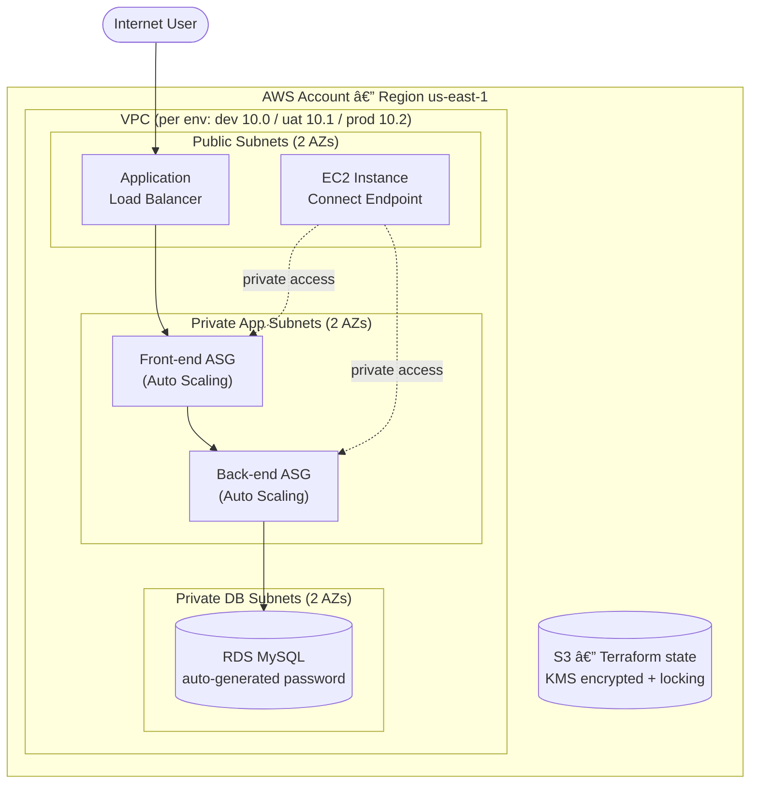

# 3-Tier AWS Infrastructure (Terraform)

[](https://github.com/rwell10-Red/roc-terraform-3tier-aws/actions/workflows/deploy.yml)


Production-style, multi-environment (dev / uat / prod) 3-tier architecture on AWS,
provisioned with Terraform and deployed through a GitHub Actions CI/CD pipeline.

**Tooling:** Terraform · AWS (VPC, ALB, EC2 ASG, RDS MySQL, S3, IAM, EICE) ·
GitHub Actions · TFLint · Checkov · Gitleaks · SonarCloud · OIDC (keyless AWS auth)

## Architecture



- **Networking** — VPC with public + private (app/db) subnets across two AZs
- **Front-end tier** — Auto Scaling Group behind an Application Load Balancer
- **Back-end tier** — Auto Scaling Group in private subnets, CPU target-tracking scaling
- **Database tier** — RDS MySQL in isolated private DB subnets, auto-generated master password
- **Access** — EC2 Instance Connect Endpoint (EICE) for private instance access (no bastion)
- **State** — Remote S3 backend with KMS encryption, versioning, and state locking

## Highlights

- Remote S3 state with encryption + locking (`use_lockfile`)
- Auto-generated RDS password via `random_password` (never stored in code)
- Latest Amazon Linux 2023 AMI auto-selected via data source
- Strong input validation on CIDRs, capacities, ports, and storage
- CI/CD with TFLint, Checkov, Gitleaks, and SonarCloud scanning
- OIDC-based AWS auth (no long-lived credentials in CI)

## Repository Layout

| Path | Purpose |
|------|---------|
| `main.tf` | Providers, S3 backend, data sources, locals, DB password |
| `vpc.tf` | VPC, subnets, route tables, gateways |
| `security_groups.tf` | Security groups for each tier |
| `alb.tf` | Application Load Balancer + target groups |
| `frontend.tf` / `backend.tf` | Launch templates, ASGs, scaling policies |
| `database.tf` | RDS MySQL instance + subnet group |
| `iam.tf` | IAM roles and instance profiles |
| `eice.tf` | EC2 Instance Connect Endpoint |
| `outputs.tf` | Stack outputs |
| `variables.tf` | Input variables with validation |
| `environments/*.tfvars` | Per-environment configuration |
| `bootstrap/` | One-time module that creates the S3 state bucket |
| `.github/workflows/deploy.yml` | CI/CD pipeline |

## Prerequisites

- Terraform >= 1.5
- An AWS account and credentials configured locally (`aws configure` or a named profile)
- AWS CLI

## Deploy to Your Own AWS Account

### 1. Create the remote state bucket (one time)

The `bootstrap/` module creates an encrypted, versioned S3 bucket for Terraform state.

```bash
cd bootstrap
terraform init
terraform apply
# Note the "bucket_name" output — you'll use it in the next step.
cd ..
```

### 2. Point the backend at your new bucket

Either edit the `bucket` value in `main.tf` (currently a placeholder), **or**
pass it at init time without editing code (recommended):

```bash
terraform init \
  -backend-config="bucket=<BUCKET_NAME_FROM_STEP_1>" \
  -backend-config="key=dev/terraform.tfstate"
```

### 3. Plan and apply an environment

```bash
terraform plan  -var-file="environments/dev.tfvars"
terraform apply -var-file="environments/dev.tfvars"
```

Swap `dev` for `uat` or `prod` to deploy other environments. Each environment uses
its own state key and its own VPC CIDR range.

### 4. Tear down

```bash
terraform destroy -var-file="environments/dev.tfvars"
```

## CI/CD Setup (GitHub Actions)

The pipeline runs lint/scan on push, then validate -> deploy on the `dev` branch.
To enable it in your repo, configure the following under
**Settings -> Secrets and variables -> Actions**:

**Secrets**
- `AWS_ROLE_ARN` — IAM role ARN in your account that trusts GitHub's OIDC provider
- `SONAR_TOKEN` — SonarCloud token (optional; remove the SonarCloud step if unused)

**Variables**
- `AWS_REGION` — e.g. `us-east-1`
- `ENVIRONMENT` — `dev`, `uat`, or `prod`

> The pipeline authenticates to AWS via OIDC role assumption — no long-lived
> access keys are stored. You must create the IAM OIDC identity provider and a
> role with a trust policy for `token.actions.githubusercontent.com` in your account.

## Notes

- `*.tfvars` are gitignored except the files under `environments/` (intentionally committed, no secrets).
- The RDS master password is generated at apply time and surfaced through Terraform state only — keep your state bucket private.
